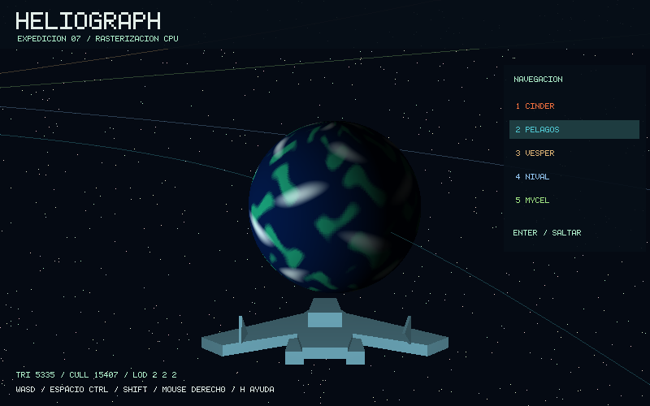

<!-- Generated with OpenAI Codex; attribution retained. -->
# HELIOGRAPH · Expedición 07

Sistema solar con **rasterización propia en CPU**. Raylib se utiliza para ventana, entrada, tiempo y matemáticas. No se usan sus funciones de dibujo, modelos, texturas o shaders. OpenGL únicamente presenta una textura que contiene el framebuffer CPU terminado, mediante un triángulo de pantalla completa; no calcula geometría, iluminación ni profundidad de la escena. Esta es la operación de presentación del framebuffer, no el renderer de los objetos.



## Ejecutar

```sh
make setup
make
make run
make test
make headless
```

Linux, compilador C99, Make, curl, cabeceras X11 y OpenGL 3.3. Para Ubuntu/Debian:

```sh
sudo apt-get install build-essential curl libasound2-dev libx11-dev libxrandr-dev libxi-dev libgl1-mesa-dev libglu1-mesa-dev libxcursor-dev libxinerama-dev
```

Ejecutar desde la raíz del proyecto. La primera compilación descarga Raylib 5.5 oficial dentro de `zig-pkg/`, excluido de Git. No se requiere Zig. `make headless` prueba el renderer sin X11 y guarda `build/cpu.ppm`.

### Error X11 / autorización

`Authorization required` significa que el proceso no puede autenticarse en el servidor gráfico; no es un error en las órbitas. `tools/run.sh` comprueba la conexión antes de abrir Raylib y prueba archivos de autorización existentes del usuario actual, sin imprimir cookies ni desactivar seguridad. Si no hay autorización válida, termina con un mensaje y código 1. El programa también realiza esta comprobación si se ejecuta directamente.

Abre una terminal dentro de tu escritorio, sin `sudo`, y ejecuta `make run`. Si persiste, comprueba `echo "$DISPLAY"` y `echo "$XAUTHORITY"` desde esa terminal. No copies valores de otra sesión ni uses `xhost +`. Una pantalla virtual permite verificar la ventana sin acceder a la sesión del escritorio:

```sh
xvfb-run -a -s '-screen 0 1280x800x24' ./build/heliograph --frames 30
```

## Controles

WASD mueve la cámara; Espacio/Ctrl modifica altura; Shift acelera. Mantén clic derecho para mirar, o usa flechas. 1–5 selecciona planeta y Enter inicia viaje animado. P pausa órbitas, O oculta trayectorias, H muestra ayuda y Esc sale. Las órbitas se congelan durante el tránsito. El sistema es estilizado, no está a escala real.

## Implementación y rúbrica

- Cinco planetas con texturas CPU distintas: Cinder, Pelagos, Vesper, Nival y Mycel. Helios es emisivo y produce iluminación Lambert por fragmento, con atenuación por distancia.
- `shade` contiene cinco shaders **de software**: lava pulsante, nubes móviles, bandas de tormenta, fracturas de hielo y bioluminiscencia nocturna. `sphere` desplaza la geometría de Nival.
- `triangle` hace back-face culling, proyección, rasterización baricéntrica, interpolación con corrección de perspectiva, sombreado y z-buffer en CPU.
- `make_spheres`, `sphere` y `choose_lod` utilizan tres mallas precalculadas (48/24/12 subdivisiones), sin generar geometría cada cuadro. Resolución interna fija 800×500, ampliada al presentar.
- `travel_point` y el bucle principal implementan viaje suave por una ruta elevada, barra de progreso y estelas animadas.
- MANTA-07 sigue la posición y orientación de la cámara; sus triángulos se procesan con el mismo rasterizador CPU.
- `obj_read` triangula caras OBJ planas simples, incluidos quads, polígonos cóncavos e índices negativos, mediante ear clipping. No admite agujeros, polígonos autointersectados o no planos ni importa materiales MTL. La nave contiene 35 quads y 2 n-gons originales, que se convierten en 92 triángulos.
- `skybox` genera estrellas direccionales en CPU; `rings` resuelve intersecciones rayo/plano y transparencia contra el z-buffer.
- `safe_move` evita atravesar sol y planetas, con barridos continuos en movimiento relativo y margen para cámara/nave. Los anillos son partículas no sólidas. Cámara con traslación X/Y/Z y orientación yaw/pitch.

## Límites de la entrega

La implementación está generada con asistencia de OpenAI Codex y conserva atribución. La aceptación académica corresponde al docente. `assets/manta.blend` es generado por IA: **no acredita modelado personal del alumno ni permite reclamar ese bono**. No se garantiza una nota. El video lo grabará y publicará el usuario; **el enlace de video está pendiente** y debe añadirse aquí antes de entregar. No se subirá el archivo de video al repositorio.

Repositorio configurado: https://github.com/MADCO-py/Proyecto-3-Space-Travel. La publicación requiere credenciales GitHub del usuario.

## Archivos para explicar

1. `src/main.c`: framebuffer, texturas, shaders CPU, triángulos, mallas, skybox, anillos, presentación y bucle de cámara.
2. `src/sim.c` y `src/sim.h`: cuerpos, órbitas, colisiones, LOD y ruta de viaje.
3. `src/obj.c`: parser OBJ y triangulación de polígonos.
4. `tests/test_sim.c`: colisiones rápidas, 25 rutas, órbitas y OBJ cóncavo.
5. `tools/model_ship.py`, `assets/manta.obj`, `assets/manta.blend`: procedencia y geometría de la nave.
6. `tools/run.sh` y `Makefile`: compilación, ejecución y comprobación de autorización X11.

## Pruebas

```sh
make test
./build/heliograph --headless --smoke --capture build/transit.ppm
./tools/visual_check.sh
```

Capturas PPM se escriben directamente desde el buffer CPU. Para probar una vista cercana: `./build/heliograph --headless --near --body 2 --frames 30 --capture build/vesper.ppm`. Las cifras de la versión anterior con renderer GPU no se aplican a esta versión. Ver [docs/VALIDATION.md](docs/VALIDATION.md).
