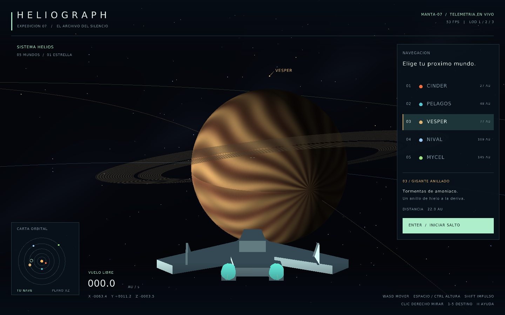

<!-- Documentación generada con asistencia de OpenAI Codex. -->
# HELIOGRAPH
### El archivo del silencio · Expedición 07

Un sistema solar de cinco mundos, una estrella y una nave de reconocimiento. Cinder presenta grietas de lava; Pelagos conserva océanos bajo nubes móviles; Vesper tiene bandas de tormenta y anillos; Nival deforma su corteza de hielo; Mycel enciende su bioluminiscencia en el hemisferio nocturno.



**Implementación con Raylib 3D/OpenGL, elegida expresamente por el usuario. No es un software renderer y no cumple la restricción de escribir únicamente píxeles en el framebuffer.** La consigna incluye una instrucción contradictoria sobre el uso de Raylib por agentes; se eligió usar dibujo 3D. El código y los assets generados están atribuidos en [ATTRIBUTION.md](ATTRIBUTION.md). Tampoco se reclama el bono de modelado personal del alumno.

Repositorio: https://github.com/MADCO-py/Proyecto-3-Space-Travel

## Ejecutar en Linux

Requiere un compilador C99, Make, curl, bibliotecas de desarrollo X11/OpenGL y un escritorio con OpenGL 3.3. Zig no es necesario. La carpeta de dependencias se llama `zig-pkg` para seguir el requisito de exclusión de la consigna y está en `.gitignore`.

En Ubuntu/Debian:

```sh
sudo apt-get install build-essential curl libasound2-dev libx11-dev libxrandr-dev libxi-dev libgl1-mesa-dev libglu1-mesa-dev libxcursor-dev libxinerama-dev
make setup
make
make run
```

La primera compilación descarga Raylib **5.5** de su repositorio oficial. Ejecutar desde la raíz del proyecto para resolver `assets/`. La aplicación muestra un mensaje de error si no puede abrir la ventana o cargar los shaders/modelos. El script solo prepara dependencias dentro del proyecto y no instala nada globalmente.

## Controles

| Entrada | Acción |
|---|---|
| W / S | Avanzar / retroceder en la dirección de la cámara |
| A / D | Desplazarse lateralmente |
| Espacio / Ctrl izquierdo | Subir / bajar en Y |
| Shift izquierdo | Impulso |
| Mantener clic derecho | Mirar con el mouse |
| Flechas | Mirar con el teclado |
| 1–5 o clic en el panel | Seleccionar un mundo |
| Enter o botón de salto | Viajar al destino con transición de 3,6 segundos |
| P | Pausar / reanudar órbitas |
| O | Mostrar / ocultar trayectorias |
| Home | Restaurar la vista general |
| H | Mostrar / ocultar ayuda |
| F11 | Pantalla completa |
| Esc | Salir |

Las órbitas se congelan durante el salto para mantener un destino estable. La ruta se eleva sobre el plano orbital, utiliza interpolación suave y mantiene activas las colisiones. Las estelas, el campo de visión y una barra de progreso acompañan el movimiento. La selección se bloquea mientras dura el tránsito. Los tamaños, velocidades, distancias y unidades AU son ilustrativos, no una escala astronómica real.

## Correspondencia con la rúbrica

| Requisito | Implementación y evidencia |
|---|---|
| Sol y varios planetas orbitando | Helios y cinco órbitas circulares inclinadas; `src/sim.c` |
| Textura distinta por planeta | Seis texturas deterministas de 768×384 generadas en CPU, con mipmaps; `planet_texture` |
| Shader único por planeta | Cinco programas compilados con `BODY_KIND`; lava pulsante, nubes animadas, bandas móviles, desplazamiento geométrico del hielo y emisión nocturna |
| Estrella que ilumina | Dirección por fragmento hacia el origen, Lambert y atenuación por distancia; `world.fs`. El anillo recibe sombra de Vesper en `ring.fs` |
| Back-face culling | `rlEnableBackfaceCulling`; se desactiva temporalmente para el interior del cielo y las dos caras del anillo |
| LOD | Tres mallas compartidas precargadas, subdivisiones 80/36/14, seleccionadas por distancia a la superficie respecto del radio. Conteo visible en HUD |
| Rendimiento | Mallas reutilizadas, texturas generadas solo al inicio, mipmaps y máximo de 50 ms por paso de simulación; no se generan mallas en el bucle |
| Fast travel y efecto | Ruta elevada, interpolación smoothstep, estelas, animación de FOV y progreso; `start_travel`, `travel_point` |
| Nave que sigue cámara | MANTA-07 con motores emisivos; transformación por orientación y posición de cámara |
| Archivo Blender | `assets/manta.blend`, regenerable; **generado por IA, no prueba de autoría personal del alumno** |
| Modelos con quads y n-gons | Parser OBJ propio con ear clipping; nave con 35 quads y 2 n-gons, que produce 92 triángulos para OpenGL. Admite polígonos simples planos cóncavos, índices negativos y tokens `v/vt/vn` |
| Skybox con estrellas | Esfera interior anclada a cámara; estrellas y banda galáctica procedural en coordenadas direccionales |
| Evitar atravesar cuerpos | Barrido continuo de esfera contra movimiento relativo de planetas; margen que envuelve cámara y nave, corrección de solapamiento y aviso de proximidad |
| Movimiento 3D de cámara | Traslación en X/Y/Z y orientación yaw/pitch |
| Software renderer / solo framebuffer | **No implementado:** esta variante utiliza funciones 3D y 2D de Raylib según la elección del usuario |

Los anillos se consideran partículas no sólidas; las superficies de los planetas y la estrella tienen colisión. La iluminación planetaria no incluye sombras entre planetas ni penumbras. El loader valida índices y triangulación, no importa materiales MTL, texturas UV o normales del OBJ: calcula normales planas para la nave. No se admiten polígonos con agujeros, autointersecciones o no planos. El desplazamiento de Nival es menor que el margen de colisión.

## Verificación

```sh
make test
# Requiere xvfb instalado para una pantalla virtual:
xvfb-run -a -s '-screen 0 1440x900x24' ./tools/visual_check.sh
# Vista cercana y captura (índice de planeta 0–4):
./build/heliograph --near --body 2 --frames 120 --capture build/vesper.png
# Prueba de tránsito completo:
./build/heliograph --smoke
```

Las pruebas verifican barridos de alta velocidad, solapamientos, radios orbitales, fronteras de LOD, 25 rutas entre pares de destinos y triangulación de una L cóncava con área conocida, además de índices inválidos y el OBJ real. `visual_check.sh` carga los cinco mundos, detecta avisos de carga/shaders y ejecuta un salto completo. Los parámetros de frames y captura sirven para verificación sin intervención; no alteran la experiencia normal.

Consulta [docs/VALIDATION.md](docs/VALIDATION.md) para el entorno y las mediciones realizadas. El CI incluido compila, ejecuta las pruebas y abre una sesión de humo en Linux; su resultado remoto solo se conocerá al ejecutarse en GitHub.

## Organización

- `src/sim.*`: órbitas, colisiones, LOD y ruta de viaje.
- `src/obj.*`: parser y triangulador OBJ.
- `src/main.c`: ventana, recursos, entrada, cámara, escena y HUD.
- `assets/shaders/`: iluminación, cinco variantes de superficie, cielo y anillos.
- `assets/manta.obj` / `assets/manta.blend`: nave y su fuente Blender.
- `tools/model_ship.py`: generación reproducible de ambos modelos.
- `tests/test_sim.c`: pruebas de comportamiento sin ventana.

Para regenerar la nave:

```sh
python3 tools/model_ship.py                 # OBJ
blender --background --factory-startup --python tools/model_ship.py  # OBJ y .blend
```
